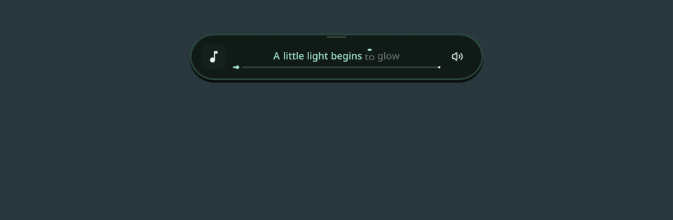
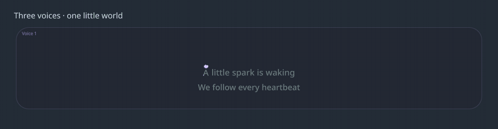
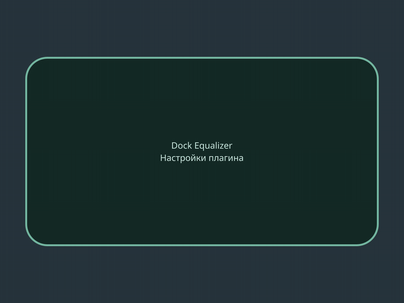

# SekaiPOP Dock Equalizer & Living Wallpapers

> **3.0.0-rc.1 — native extension preview.** Requires a proposed shell API, currently absent from official SekaiPOP. [Integration status and patch](docs/NATIVE-INTEGRATION.md). install.py is now a no-op notice. The last adapter-based stable release is [2.22.0](https://github.com/Aferon-08/sekaipop-dock-equalizer/releases/tag/v2.22.0).

[](https://github.com/Aferon-08/sekaipop-dock-equalizer/actions/workflows/checks.yml) [](https://github.com/Aferon-08/sekaipop-dock-equalizer/releases) [](LICENSE)

[Русский](README.md) · [Installation](docs/INSTALL.md) · [Releases](https://github.com/Aferon-08/sekaipop-dock-equalizer/releases)

An independent extension for **[SekaiPOP](https://github.com/Blapples/SekaiPop)** on Hyprland: a liquid music dock, word-timed lyrics and procedural glass wallpapers with a tiny firefly companion. **Version 2.22.0 · GPL-3.0.** The settings UI and detailed documentation are currently primarily in Russian.




[Dock video](docs/media/dock.mp4) · [Wallpaper video](docs/media/wallpaper.mp4)

These are recordings of the real QML components in a controlled demo scene, using original sample text and a synthetic spectrum, with no audio. The wallpaper split is triggered early for the short demo. These clips are not performance benchmarks.



The multi-voice demo uses explicitly tagged sample data; it demonstrates the UI, not automatic voice-recognition accuracy. [Video](docs/media/voices.mp4).

## 2.22.0 — Liquid settings panel

**55 settings**, search, smooth scrolling and per-setting / confirmed full reset. The phone morphs through an irregular glass droplet into a taller settings panel, then returns on Back or Escape. [Settings catalogue (RU)](docs/SETTINGS.md).



The demo uses a sample phone with the real settings component. [Video](docs/media/settings.mp4).

## Features

- Two spring-animated visualizer capsules that merge into the dock; waveform and bars, mirrored left side, system palette.
- Compact and expanded music layouts, cover art, title, playback controls and a wavy progress indicator. Hover restores app icons.
- Animated lyric lines and word progress, a bouncing marker, landing splashes, waiting dots and a separate trailing firefly.
- Multiple lyric regions, synchronized chorus merging, backing phrases and animated per-voice endings.
- Optional local word alignment, JSON import and experimental voice analysis; separate CPU/NVIDIA CUDA runtimes.
- Procedural compositions per monitor sharing one palette, glass and opaque shapes, entrance animation, bar/widget avoidance and restrained ambient motion.
- A wallpaper companion with goals, independent twin journeys, physical tube routes, elastic nearby transitions and bubble travel to otherwise unreachable rooms.

Voice analysis is **experimental**: a dense mix or missing parallel text can prevent reliable voice-specific lyrics. Names are not inferred as identities; unnamed roles receive numbered labels. Basic visuals work without any ML runtime.

## Install this preview

See [NATIVE-INTEGRATION.md](docs/NATIVE-INTEGRATION.md). The plugin is now pure native surface components; no shell-file patching or install hook. It requires the proposed shell extension API. Old install.py/--repair instructions apply only to tag v2.22.0.

## Use and data

Open **SekaiPOP Settings → Desktop → Plugins → Dock Equalizer**. Start an MPRIS-compatible player. On an empty desktop, the horizontal dock expands; click the cover to open word-timing settings. Prepare the optional engine before requesting generation with the small glass-area button or the regenerate action.

Heavy analysis is **manual**. Spotify capture is **enabled by default** and separately saves the Spotify playback stream locally from the beginning of a track, even before analysis is requested. A complete pass is required. Disable it in plugin settings if unwanted; raw audio takes roughly **10 MB per minute**. The microphone is not used. Model setup and online lyric/YouTube sources may use the network; audio inference runs locally. See [PRIVACY.md](docs/PRIVACY.md).

CUDA is for audio analysis and does not automatically move the shell renderer to the discrete GPU. The installer checks known source anchors and stops if the shell layout is incompatible. Future SekaiPOP revisions may need a new adapter.

## Develop

```sh
python3 build-pet-worker.py --check
node tests/tube-and-family.mjs
node tests/bubble-family.mjs
```

See [DEVELOPMENT.md](docs/DEVELOPMENT.md) for rendering demos and compiling the shipped shader sources, [CONTRIBUTING.md](CONTRIBUTING.md) for contributions, and [THIRD_PARTY.md](THIRD_PARTY.md) for upstream projects. Licensed under [GPL-3.0](LICENSE).
