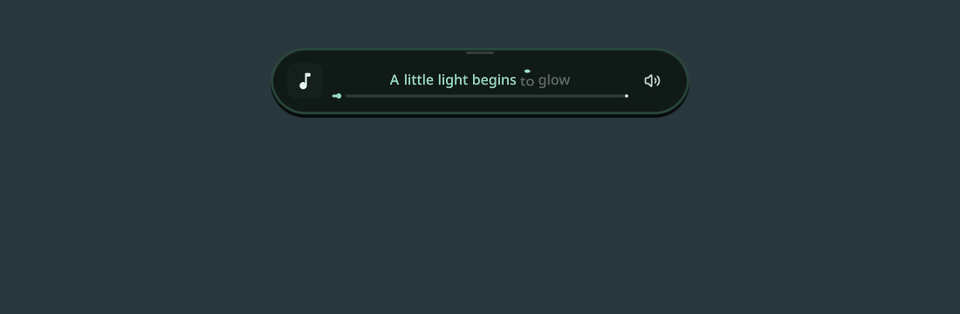
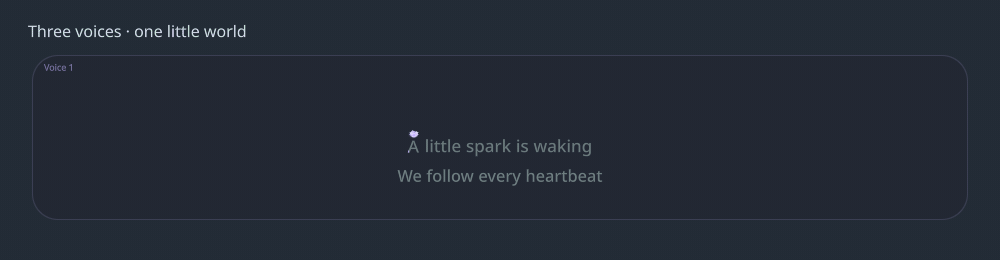

# SekaiPOP Dock Equalizer & Living Wallpapers

[](https://github.com/Aferon-08/sekaipop-dock-equalizer/actions/workflows/checks.yml) [](https://github.com/Aferon-08/sekaipop-dock-equalizer/releases) [](LICENSE)

[English](README.en.md) · [Установка](docs/INSTALL.md) · [Настройки и лирика](docs/USAGE.md) · [Устранение проблем](docs/TROUBLESHOOTING.md) · [Релизы](https://github.com/Aferon-08/sekaipop-dock-equalizer/releases)

Музыкальный док и процедурные обои для **[SekaiPOP](https://github.com/Blapples/SekaiPop)** на Hyprland. Капсулы визуализатора вытекают из дока, лирика подсвечивается по словам, а маленький огонёк живёт в стеклянных фигурах рабочего стола.

Это независимое расширение с локальными адаптерами оболочки. **Не отдельная оболочка и не официальный модуль SekaiPOP.** Текущая версия: **2.21.2**, GPL-3.0; основной интерфейс настроек — на русском.

## Посмотреть

### Музыкальный док



Две боковые капсулы, пружинное раскрытие, стеклянная лирика, обложка, управление и волнистый прогрессбар. Огонёк преследует отдельную прыгающую точку, оставляя мягкий след.

[Смотреть MP4](docs/media/dock.mp4) · [Скачать видео](https://raw.githubusercontent.com/Aferon-08/sekaipop-dock-equalizer/main/docs/media/dock.mp4)

### Живые обои


Объёмные матовые и стеклянные фигуры, общая системная палитра, отдельная композиция для каждого монитора. Огонёк гуляет внутри стекла, танцует под музыку и иногда разделяется на двух друзей.

[Смотреть MP4](docs/media/wallpaper.mp4) · [Скачать видео](https://raw.githubusercontent.com/Aferon-08/sekaipop-dock-equalizer/main/docs/media/wallpaper.mp4)

Демонстрации записаны из настоящих QML-компонентов **2.21.2** в изолированной сцене: тестовый текст и синтетический спектр, без аудиозаписи. Событие разделения огонька вызвано раньше обычного, чтобы его было видно в коротком ролике. Видео не является измерением производительности.

### Несколько голосов



В этой демонстрации роли заданы тестовой разметкой; она показывает интерфейс, а не результат автоматического распознавания песни. [MP4](docs/media/voices.mp4).

## Что умеет

| Модуль | Возможности |
|---|---|
| Визуализатор | Волна или столбики; зеркальный левый канал; цвета темы; пружинное выдвижение и слияние с доком. |
| Музыкальный док | Компактный и расширенный режимы; название, исполнитель, обложка, управление, волнистый прогресс. Иконки возвращаются при наведении. |
| Лирика | Построчные и пословные тайминги, прыгающая точка, брызги при приземлении, анимация смены строк, ожидание и финал `The end of lyrics :)` → `The end :)`. |
| Несколько голосов | Отдельные области партий, удержание разделённого вида, объединение синхронных строк, подпевки над основной строкой. При отсутствии имени — «Голос 1», «Голос 2» и т. д. |
| Локальный анализ | Импорт JSON, выравнивание готового текста по аудио, дополнительный анализ голосов, CPU или отдельное NVIDIA CUDA-окружение. |
| Обои | Случайная спокойная/насыщенная сцена; чёрный старт → фон → свет → фигуры; мягкие движения и блики; учёт бара и расположения виджетов. |
| Обойный питомец | Цели и маршруты, трубы между далёкими фигурами, переходы через упругие оболочки, путешествия внутри пузырька, самостоятельные маршруты близнецов и встреча в месте разделения. |

**Важные границы:** анализ голосов экспериментальный. Качество зависит от микса и источника текста; отдельные параллельные партии не всегда можно восстановить. Это не обещание безошибочной расшифровки любого трека. [Подробнее](docs/USAGE.md#голоса-и-ограничения-анализа).

## Быстрая установка

Нужны уже установленный SekaiPOP с API плагинов 1, Quickshell, Hyprland, Python 3, CAVA и PipeWire-Pulse/PulseAudio. Проверенная конфигурация: SekaiPOP `1.0.0` / commit [`69e1df0`](https://github.com/Blapples/SekaiPop/commit/69e1df0f282ca9a5193c1a628b346e5df01c7d93), Quickshell `0.3.2`, Qt `6.12`, Hyprland `0.57`.

```sh
git clone https://github.com/Aferon-08/sekaipop-dock-equalizer.git
cd sekaipop-dock-equalizer
python3 install.py
```

Установщик создаёт резервную копию и перезапускает оболочку. Он добавляет адаптеры в **Dock.qml, WallpaperLayer.qml и EditChrome.qml**; обычного добавления папки плагина через менеджер SekaiPOP недостаточно.

**При полной установке/переустановке очищаются сохранённые записи Spotify, разметки и отметки прослушивания; создаётся новый seed обоев.** Обновление с сохранением данных:

```sh
git pull --ff-only
python3 install.py --repair
```

`--repair` также возвращает подключения после обновления SekaiPOP, перезаписавшего файлы оболочки. Если структура файлов не распознана, установщик прекращает работу до её изменения.

[Полная инструкция: зависимости, CPU/CUDA, удаление и резервные копии](docs/INSTALL.md).

## Начать пользоваться

1. Откройте **Настройки SekaiPOP → Desktop → Plugins → Dock Equalizer**.
2. Запустите музыку в MPRIS-совместимом плеере. Визуализатор использует монитор выбранного системного аудиовыхода, а не микрофон.
3. На пустом рабочем столе горизонтальный док раскрывается. Обложка открывает окно таймингов.
4. Для локального анализа сначала подготовьте обработчик. Нажмите небольшой значок в стеклянной области или «Перегенерировать»: тяжёлый анализ запускается **по запросу**.
5. Процедурные обои, лёгкое движение и обойный огонёк включаются отдельно в настройках.

**Запись Spotify включена по умолчанию.** Она сохраняет локально поток самого Spotify с начала песни для будущего анализа, даже если генерация ещё не запрошена. Нужен полный проход трека с начала. Её можно отключить параметром «Запись Spotify для лирики». Около **10 МБ/мин** записи. Облачного распознавания в этом плагине нет; получение лирики, подготовка моделей и YouTube-источник могут требовать сеть. [Данные и приватность](docs/PRIVACY.md).

## Документация

- [Установка, обновление, удаление](docs/INSTALL.md)
- [Настройки, управление, тайминги и несколько голосов](docs/USAGE.md)
- [Процедурные обои и поведение огонька](docs/WALLPAPERS.md)
- [Производительность, диагностика и известные ограничения](docs/TROUBLESHOOTING.md)
- [Устройство проекта, сборка шейдеров и проверки](docs/DEVELOPMENT.md)
- [История последних изменений](CHANGELOG.md)
- [Сторонние проекты и благодарности](THIRD_PARTY.md)
- [Как помочь проекту](CONTRIBUTING.md)

## Совместимость

Адаптеры опираются на внутренние компоненты оболочки: официальный API 1 не предоставляет слот расширения дока. Поддержка всех будущих версий SekaiPOP не гарантируется. Сначала используйте `--repair`; при отказе приложите версию оболочки и журнал в [issue](https://github.com/Aferon-08/sekaipop-dock-equalizer/issues).

Обои и базовая визуализация не требуют моделей машинного обучения. Тяжёлые модели устанавливаются отдельно и в репозиторий не включены. CUDA ускоряет анализ аудио; она **не переключает автоматически отрисовку всей оболочки на дискретную видеокарту**.

## Лицензия

[GNU GPL v3](LICENSE). Исходники и сборочные инструменты шейдеров включены. SekaiPOP и загружаемые сторонние инструменты/модели имеют собственные условия; см. [THIRD_PARTY.md](THIRD_PARTY.md).
